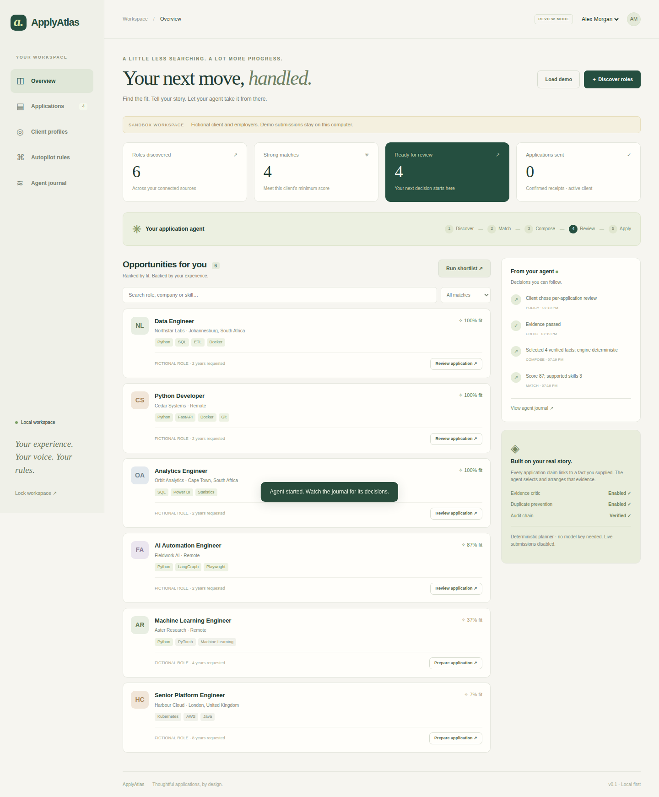

# ApplyAtlas

An advanced job application agent workspace built with LangGraph, FastAPI, Playwright and SQLite.

**[Open the project and setup guide →](applyatlas/README.md)**

**42 tests passed**, including actual Chromium sandbox submission and mobile dashboard checks. [View the successful run](https://github.com/OagengKunene/Githubtest/actions/runs/41702022893).

Find roles, explain fit, prepare evidence-grounded application documents, review packets or define scoped automatic application mandates, and track submission receipts. Includes a local employer sandbox and an operator dashboard.

- [How it works and quick start](applyatlas/README.md)
- [Architecture and original features](applyatlas/docs/ARCHITECTURE.md)
- [Open-source research and attribution](applyatlas/docs/OPEN_SOURCE_RESEARCH.md)
- [Validation record](applyatlas/docs/VALIDATION.md)

Live submissions require client authorisation and server configuration. Read the validation record for tested scope and browser limitations.

The previous placeholder README is preserved in [the project history note](applyatlas/docs/ORIGINAL_REPOSITORY_README.md).
