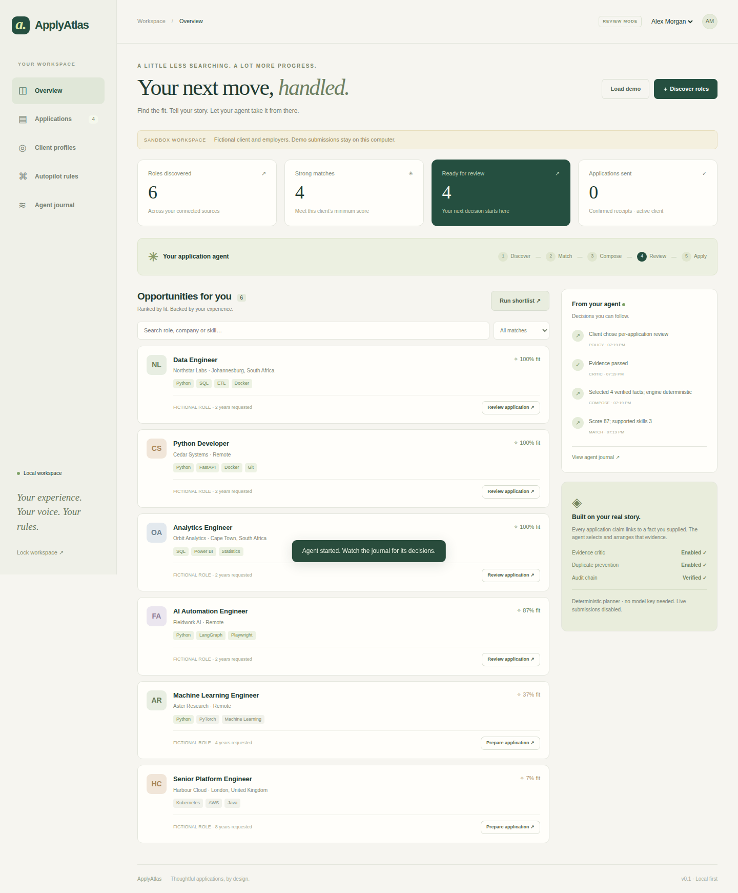
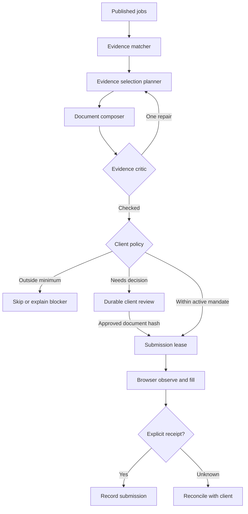

# ApplyAtlas

**An agentic job application workspace that acts for a client, with a verifiable reason behind every application.**

ApplyAtlas discovers roles, explains fit, selects verified experience, prepares a tailored resume and cover letter, and fills supported employer application forms. Clients can review each packet or authorise automatic submission within an explicit, expiring mandate.

Built with **LangGraph + FastAPI + Playwright + SQLite**. Runs locally. Includes a complete fictional employer sandbox that works without an LLM key.



**Verified:** [42 tests passed in GitHub Actions](https://github.com/OagengKunene/Githubtest/actions/runs/41702022893), including actual Chromium sandbox submission and the desktop-to-mobile dashboard flow.

## What problem it solves

Job seekers repeat the same search, screening, tailoring, form filling, and tracking work for every role. Career advisers repeat that work for multiple clients. ApplyAtlas turns it into a persistent, inspectable workflow while keeping each client's factual experience and application rules together.

This is a working local operator application, suitable for development, demonstration and controlled pilots. It is not a hosted recruitment SaaS or a promise that arbitrary job portals can be automated.

## What it actually does

| Capability | Implementation |
|---|---|
| Job discovery | Public Greenhouse and Lever company boards; optional JobSpy/Indeed adapter; manual job import |
| Explainable matching | Skill evidence 60%, title overlap 20%, preferred location 10%, stated experience 10%; visible breakdown and gaps |
| Agent planning | Optional OpenAI-compatible model selects and orders existing evidence IDs; no free-form career claims |
| Tailored documents | Cover letter and downloadable PDF evidence resume assembled from selected client facts |
| Evidence critic | Checks selected IDs and exact fact text; one bounded repair pass before a hard gate |
| Durable review | LangGraph SQLite checkpoints and `interrupt()` / `Command(resume=...)` survive process restarts |
| Scoped automatic application | Exact company and host allowlists, minimum score, no skill gaps, active expiry and daily attempt budget |
| Browser execution | Bounded form observation, field mapping, PDF upload, verification, Submit and explicit receipt detection |
| Submission ledger | Atomic SQLite intent reservation prevents concurrent duplicate attempts; unknown outcomes require reconciliation |
| Client workspace | Multiple profiles under one local owner, applications, mandates, event journal and recorded outcome insights |
| Local protection | Fernet-encrypted profiles, packets, receipts and checkpoint payloads; owner-token API; localhost binding |
| Continuous campaigns | CLI loop discovers company-board roles and runs the same agent, with a minimum five-minute interval |

The demo uses fictional client **Alex Morgan** and six fictional employers. Its submission path uses Playwright against a local test employer. Demo receipts are labelled as fictional everywhere they are shown. See the validation record for the current browser test status.

## Quick start

Python 3.11+ is required. Use 3.12 to match the tested environment.

```bash
git clone https://github.com/OagengKunene/Githubtest.git
cd Githubtest/applyatlas
python -m venv .venv
```

Activate the environment:

```bash
# Windows PowerShell
.venv\Scripts\Activate.ps1
# macOS / Linux
source .venv/bin/activate
```

```bash
python -m pip install -e ".[dev]"
python -m playwright install chromium
applyatlas serve
```

Open **http://localhost:8000**. In a second terminal in the same directory, activate the environment and run:

```bash
applyatlas token
```

Paste the token into the workspace. The UI keeps it only in the current tab's memory.

1. Click **Load demo**.
2. Click **Prepare application** beside Data Engineer.
3. Open the application, inspect its facts, cover letter and PDF.
4. Click **Approve & test application**.
5. See the sandbox receipt under Applications and the agent decisions in Agent journal.

No employer is contacted by that flow. An LLM key is not needed.

If browser downloads are unavailable but Chromium is already installed, set `APPLYATLAS_BROWSER_EXECUTABLE` to that browser's executable path. The project uses Playwright's managed Chromium by default.

## How the agents work



LangGraph owns routing, bounded repair, state and resumable review. The optional model makes a semantic evidence selection decision. The browser executor follows a constrained observation/action plan rather than giving an unrestricted model control of the client's account. In no-key mode the planner ranks existing facts deterministically; packets explicitly identify that mode.

## Original project features

**Evidence passport.** Each client fact has an ID and associated skills. Submitted experience paragraphs are exact copies of those facts. The LLM can select facts but cannot invent a degree, employer, qualification, salary, certification or work history. The client must still verify their own source facts.

**Approval tied to the actual packet.** Review approves a SHA-256 document hash. The executor also checks a profile/job/policy snapshot hash. Changing the client's facts, the job text or mandate blocks an old approval.

**Uncertain-outcome ledger.** Before touching an application form, the worker atomically reserves an application attempt and daily quota. If a browser crashes after Submit, the system does not infer success or blindly retry. This reduces duplicate external side effects; it cannot create an exactly-once guarantee across an employer's website.

**A real sandbox employer.** The complete graph, client review and browser submission can be exercised without publishing personal information or using a paid model.

**Source outcome insights.** Record interview, offer and rejection outcomes to compare sources. The dashboard shows a Beta(1,1)-smoothed positive response rate and sample size. This is descriptive feedback; it does not secretly alter matching weights or predict hiring success.

## Use it for a real client

Create a profile in **Client profiles**, replace the example statements with verified experience and save it. Use one profile per client. The JSON editor exposes the complete typed schema without hidden assumptions. This version takes structured facts; automatic PDF-to-profile extraction is not implemented.

Discover a company's board using the board slug from its careers URL. Greenhouse and Lever discovery uses public GET endpoints. Query filtering applies within that company, not across all employers. Public ATS APIs do not require an employer API key for discovery. Their application POST APIs require employer credentials, so ApplyAtlas uses the applicant-facing hosted form instead.

Supported application hosts:

- `boards.greenhouse.io`
- `job-boards.greenhouse.io`
- `jobs.lever.co`
- `jobs.eu.lever.co`

Known text fields and resume uploads can be automated. Unknown required questions, required choices or consent checkboxes, authentication and visible CAPTCHAs pause execution for the client. Workday, LinkedIn Easy Apply, email applications and arbitrary custom portals do not have submission adapters in this release. Optional JobSpy discovery does not add submission support for those portals.

### Optional language model

Copy `.env.example` to `.env` and set:

```dotenv
APPLYATLAS_LLM_BASE_URL=https://api.openai.com/v1
APPLYATLAS_LLM_API_KEY=your-key
APPLYATLAS_LLM_MODEL=your-json-capable-model
```

The provider must implement `/chat/completions` with JSON response mode. You can also use an appropriate local OpenAI-compatible server. Only job text and evidence statements/skills are sent to the planner; contact fields are excluded. Evidence text can itself contain personal information, so choose a provider the client has authorised. Provider errors and invalid JSON fall back to the labelled deterministic planner.

### Automatic submission mandate

In **Autopilot rules**, configure the client's exact employer allowlist, application domains, minimum score, daily attempt limit and expiry. Automatic submission requires a current mandate, no detected evidence gaps or review warnings, a passed critic, a supported host, an unused attempt and an available quota slot. Mandate scope is checked again immediately before execution.

Live employer submissions additionally require an intentional server setting:

```dotenv
APPLYATLAS_LIVE_SUBMIT=true
```

Review mode also requires this setting to submit a live application after approval. A disabled or interrupted attempt remains visible for checking and does not automatically retry. The current version offers no retry button: reconcile the employer's portal before a developer deliberately resets an attempt. Daily budgets use UTC dates and count reservations, including blocked/failed browser attempts.

### Optional wider discovery

```bash
python -m pip install -e ".[jobspy]"
```

The optional adapter searches Indeed using the South Africa country setting. JobSpy is imported as a normal dependency; no upstream scraping code has been copied. Use permitted sources and stop where a portal requires human interaction.

### Campaign worker

Create `campaign.json` using the ID shown in the saved client profile:

```json
{
  "candidate_id": "your-client-id",
  "interval_seconds": 1800,
  "sources": [
    {"source": "greenhouse", "board": "company-board-slug", "query": "engineer", "limit": 20},
    {"source": "lever", "board": "another-board-slug", "query": "data", "limit": 20}
  ]
}
```

```bash
applyatlas campaign --config campaign.json --once
applyatlas campaign --config campaign.json
```

Run the campaign as the **only agent writer** for that data directory. Do not run it concurrently with the web server: submission leases protect external attempts, but graph checkpoint writes are designed for one operator process. Stop the campaign and open the server to review queued packets. A campaign in review mode prepares applications; an authorised autopilot campaign can submit eligible supported forms. The separate process keeps discovering while it runs; closing it stops the schedule. Source errors are recorded and retried on the next cycle, not in an unbounded retry loop.

## Run tests

```bash
python -m pytest -q
ruff check .
```

`tests/test_browser.py` runs a real Chromium submission against a loopback-only test server. It fails when Chromium is missing rather than pretending browser automation was verified. `tests/test_graph.py` covers durable resume, stale approvals, evidence repair, policy routing and duplicate avoidance. `tests/test_store.py` checks concurrent quota reservations, encryption and log tampering. Connector tests mock the official response formats; they do not contact employers.

See [validation](docs/VALIDATION.md), [architecture](docs/ARCHITECTURE.md), [open-source research and attribution](docs/OPEN_SOURCE_RESEARCH.md), and [operating limitations](docs/OPERATIONS.md).

## Containers

```bash
docker compose up --build
docker compose exec applyatlas applyatlas token
```

The compose configuration uses host networking and the server still binds loopback. It targets Linux Docker hosts; on Windows, use the Python quick start or Docker Desktop host-networking support. Keep the `data` directory and encryption key together when backing up. Do not expose the local owner API on the public internet.

## Project layout

```text
src/applyatlas/   API, LangGraph workflow, connectors, evidence planner and browser executor
src/applyatlas/static/   Dependency-free operator dashboard
tests/           Unit, API and browser integration tests
docs/            Architecture, attribution, operation and validation
```

MIT licence for original ApplyAtlas code. Third-party dependencies retain their respective licences. Existing application projects informed the feature research; this implementation was written independently. See [THIRD_PARTY_NOTICES.md](THIRD_PARTY_NOTICES.md).
